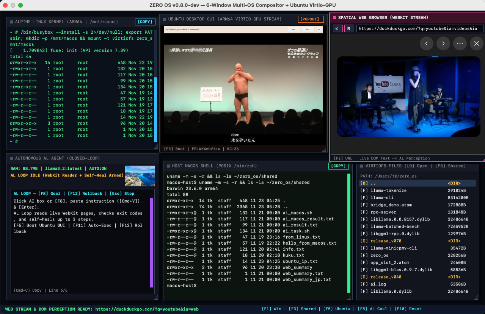
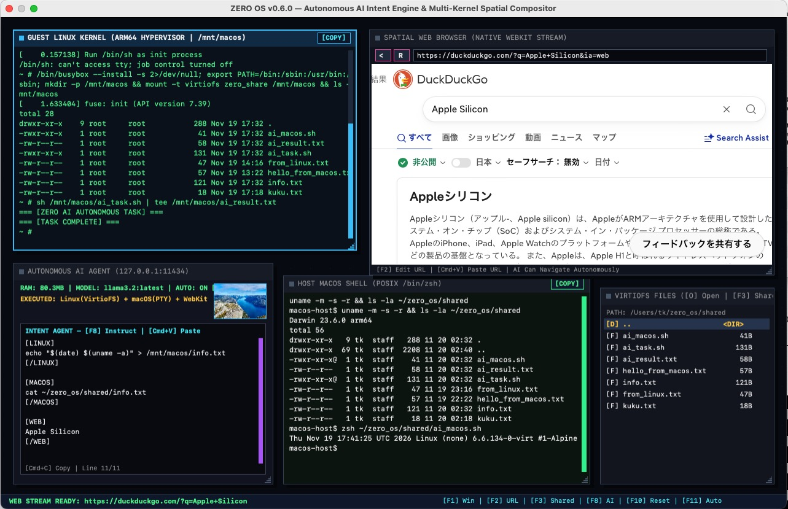
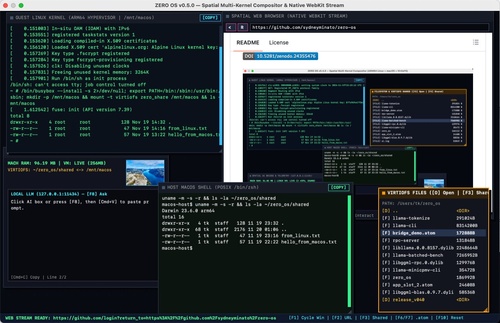
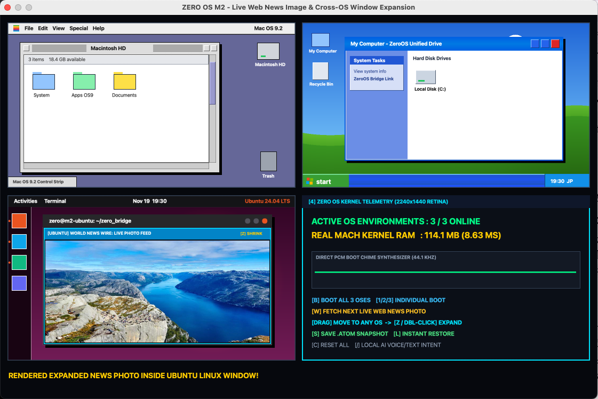

# ZERO OS (`v0.8.0`) — Virtio Audio, Clipboard Sharing & Multi-OS Spatial Compositor

**ZERO OS** is a lightweight native spatial operating environment and multi-OS compositor written in C and Objective-C for macOS. In **`v0.8.0`**, ZERO OS adds hardware-backed Virtio audio output, bidirectional clipboard sharing, and rendering stability guards (`draw_text`), making a full Debian 12 ARM64 XFCE desktop run smoothly alongside host WebKit media, Alpine Linux, and a local AI agent on an 8GB Apple Silicon Mac.

---

## What is New in `v0.8.0`

- **Virtio Audio Output (`VZVirtioSoundDeviceConfiguration`)**: Routes guest OS audio (Debian 12 ARM64 with `bookworm-backports` `virtio_snd` kernel module and PipeWire) directly to the macOS host sound output.
- **Bidirectional Clipboard Sharing (`VZSpiceAgentPortAttachment`)**: Enables seamless copy-and-paste (`sharesClipboard = YES`) between macOS and the Linux virtual machine.
- **Lightweight Multimedia & GUI Balance**: Verified smooth simultaneous dual video playback (Linux VM browser + host spatial WebKit pane) alongside Alpine Linux and a local LLM agent on an 8GB M2 Mac mini (2GB RAM allocated to Debian 12 ARM64 + XFCE + Epiphany + Fcitx 5 + Mozc).
- **Rendering Crash Fix (`draw_text`)**: Added `nil` guards and safe fallbacks for font, color, and size attributes in `zero_core.c` (`draw_text`) to prevent `NSDictionary` exceptions during rendering.

---

## Evolution & Version History (`v0.8.0` → `v0.1.0-alpha`)

### `v0.7.0` — Closed-Loop AL (Autonomous Layer) & Multi-Kernel Spatial Compositor

- **Closed-Loop Perception-Action-Verification (`Observe -> Reason -> Act -> Verify`)**: Upgraded from one-shot command dispatch to a multi-step autonomous loop (up to 3 steps) that reads live execution results and adapts subsequent actions.
- **Live WebKit DOM Perception**: Extracts real-time page titles and cleaned body text from the spatial `WKWebView` viewport into the AL perception buffer.
- **Exit-Code Telemetry & Self-Healing (`LINUX_EXIT` / `MACOS_EXIT`)**: Captures exit codes and stdout/stderr across guest Linux (`/mnt/macos/ai_result.txt`) and host macOS (`~/zero_os/shared/ai_macos_result.txt`) to verify completion or self-heal errors.

### `v0.6.0` — Autonomous AI Intent Engine & Multi-Kernel Spatial Compositor

- **Autonomous Cross-OS AI Execution (`[LINUX]` / `[MACOS]` / `[WEB]`)**: Translates natural-language instructions into executable scripts dispatched across the guest Linux kernel via VirtioFS (`/mnt/macos/ai_task.sh`), the host macOS shell (`~/zero_os/shared/ai_macos.sh`), and the spatial `WebKit` browser.
- **Automatic Cross-OS Path Normalization**: Rewrites path mismatches (`~/zero_os/shared` <-> `/mnt/macos`) in real time inside the C bridge.
- **AppKit-Synchronized Overlay Pipeline**: Decoupled subview frame synchronization from `drawRect:` for steady 30 fps spatial compositing alongside web media.

### `v0.5.0` — Spatial Multi-Kernel Compositor & Native WebKit Stream

- **Zero-Bloat Spatial Web Browser (`WebKit` VSS Viewport)**: Integrated hardware-accelerated `WKWebView` into a spatial window (`WIN_BROWSER`) with dynamic Z-order occlusion handling so overlapping Linux/macOS windows naturally clip over live web content.

### `v0.4.0` — Spatial Multi-Kernel Compositor & Virtual Streaming System

- **Spatial Multi-Kernel Window Compositor**: Introduced free-form overlapping windows with Z-order focus, title-bar dragging, corner resizing (`◢`), and per-window clipping over a unified `uint32_t` framebuffer.

### `v0.3.1` — Native Hardware Hypervisor, ARM64 Linux Kernel & VirtioFS Bridge

- **Hardware Hypervisor & Native Linux Kernel Boot (`Virtualization.framework`)**: Booted an ARM64 Linux kernel (`Image` + `initramfs.img`) on Apple Silicon alongside a live host `/bin/zsh` PTY shell.
- **Bidirectional VirtioFS Direct File Sharing (`VZVirtioFileSystemDeviceConfiguration`)**: Mounted macOS `~/zero_os/shared` at `/mnt/macos` inside the guest Linux kernel.

### `v0.2.0` — Universal Native Spatial Compositor & Live PTY Kernel

- **Universal Binary (`arm64` + `x86_64`)**: Built a dependency-free C/Objective-C spatial compositor running across both Apple Silicon and Intel Macs with live POSIX filesystem traversal, `/bin/zsh` PTY terminal, Web image stream, and `.atom` state snapshots.

### `v0.1.0-alpha` — Intent-Driven, Zero-Bloat Computational Architecture

- **Initial Reference Architecture**: Established the foundational concept of mapping unified-memory state structures directly to display framebuffers and audio hardware with offline local AI mediation and `.atom` state snapshots.
