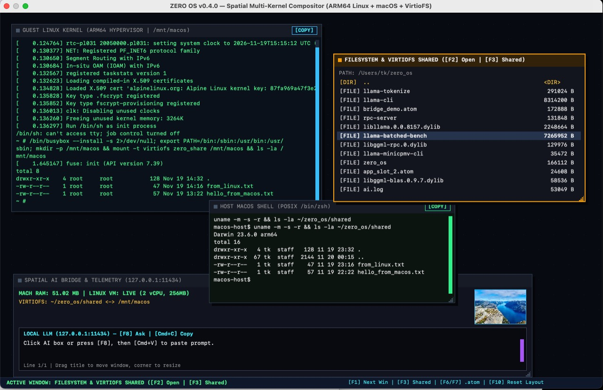
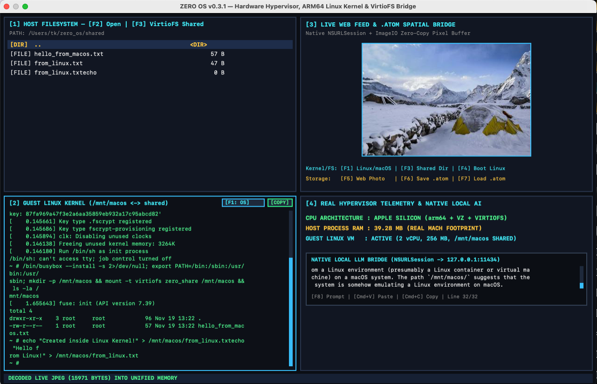
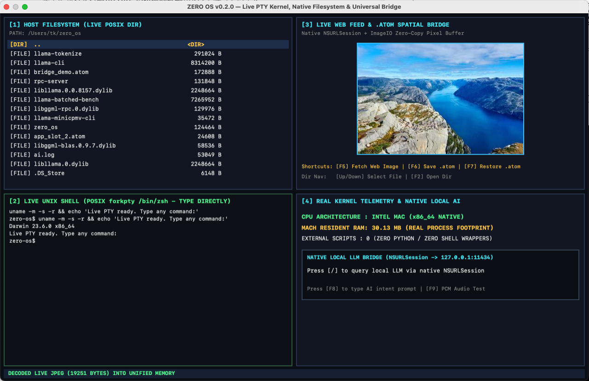

# ZERO OS (`v0.8.0`) — Virtio Audio, Clipboard Sharing & Multi-OS Spatial Compositor

[日本語での解説はこちら / Read in Japanese →](README_ja.md)

**ZERO OS** is a lightweight native spatial operating environment and multi-OS compositor written in C and Objective-C for macOS. In **`v0.8.0`**, ZERO OS adds hardware-backed Virtio audio output, bidirectional clipboard sharing, and rendering stability guards (`draw_text`), making a full Debian 12 ARM64 XFCE desktop run smoothly alongside host WebKit media, Alpine Linux, and a local AI agent on an 8GB Apple Silicon Mac.

**ZERO OS** は、macOS 上で動作する C / Objective-C 製の超軽量な空間マルチ OS コンポジタです。**`v0.8.0`** では、ハードウェア支援による Virtio 音声出力、macOS と Linux 間の双方向クリップボード共有、および描画安定化（`draw_text` の修正）を実装し、8GB メモリの Apple Silicon Mac 上で Debian 12（XFCE デスクトップ）・ホスト側 WebKit ブラウザ・Alpine Linux・ローカル AI エージェントを同時に軽快動作させる環境を確立しました。

---

## What is New in `v0.8.0` / `v0.8.0` の主な新機能・改善点

- **Virtio Audio Output (`VZVirtioSoundDeviceConfiguration`) / Virtio オーディオ出力に対応**:
  - Routes guest OS audio (Debian 12 ARM64 with `bookworm-backports` `virtio_snd` kernel module and PipeWire) directly to the macOS host sound output.
  - ゲスト OS（Debian 12 ARM64 / `bookworm-backports` カーネルの `virtio_snd` ＋ PipeWire）の音声を macOS ホスト側へ直接出力できるようにしました。
- **Bidirectional Clipboard Sharing (`VZSpiceAgentPortAttachment`) / 双方向クリップボード共有**:
  - Enables seamless copy-and-paste (`sharesClipboard = YES`) between macOS and the Linux virtual machine.
  - macOS と Linux 仮想マシン間で、テキストのコピー＆ペーストをシームレスに行えるようにしました。
- **Lightweight Multimedia & GUI Balance / 軽量マルチメディア・GUI 環境の最適化**:
  - Verified smooth simultaneous dual video playback (Linux VM browser + host spatial WebKit pane) alongside Alpine Linux and a local LLM agent on an 8GB M2 Mac mini (2GB RAM allocated to Debian 12 ARM64 + XFCE + Epiphany + Fcitx 5 + Mozc).
  - 8GB RAM の M2 Mac mini 上で、Debian 12 ARM64（メモリ 2GB 割り当て / XFCE / Epiphany / Fcitx 5 + Mozc）とホスト側 WebKit ブラウザの 2 画面同時動画再生を、Alpine Linux やローカル AI と並走させながら快適に動作することを確認しました。
- **Rendering Crash Fix (`draw_text`) / 描画クラッシュの修正**:
  - Added `nil` guards and safe fallbacks for font, color, and size attributes in `zero_core.c` (`draw_text`) to prevent `NSDictionary` exceptions during rendering.
  - `zero_core.c` の `draw_text` 関数にフォント・色・サイズの空値（`nil`）チェックとフォールバック処理を追加し、文字描画時の突然の例外終了を防止しました。

---

## Evolution & Version History / 開発の変遷（`v0.8.0` → `v0.1.0-alpha`）

### `v0.7.0` — Closed-Loop AL (Autonomous Layer) & Multi-Kernel Spatial Compositor

- **Closed-Loop Perception-Action-Verification (`Observe -> Reason -> Act -> Verify`) / 自律ループ制御（観察→推論→実行→検証）**:
  - Upgraded from one-shot command dispatch to a multi-step autonomous loop (up to 3 steps) that reads live execution results and adapts subsequent actions.
  - 単発のコマンド送信から、実行結果を読み取って次の行動を自動修正する最大 3 ステップの自律ループ制御へ進化しました。
- **Live WebKit DOM Perception / WebKit 画面内容のリアルタイム認識**:
  - Extracts real-time page titles and cleaned body text from the spatial `WKWebView` viewport into the AL perception buffer.
  - 空間内の `WKWebView` で開いている Web ページのタイトルと本文を直接取得し、ローカル AI が内容を要約・活用できるようにしました。
- **Exit-Code Telemetry & Self-Healing (`LINUX_EXIT` / `MACOS_EXIT`) / 終了コード監視と自己修復**:
  - Captures exit codes and stdout/stderr across guest Linux (`/mnt/macos/ai_result.txt`) and host macOS (`~/zero_os/shared/ai_macos_result.txt`) to verify completion or self-heal errors.
  - ゲスト Linux とホスト macOS 双方の終了コード・標準出力を取得し、完了確認やエラー時の自動リカバリを実現しました。

### `v0.6.0` — Autonomous AI Intent Engine & Multi-Kernel Spatial Compositor

- **Autonomous Cross-OS AI Execution (`[LINUX]` / `[MACOS]` / `[WEB]`) / OS 横断の自律 AI 実行**:
  - Translates natural-language instructions into executable scripts dispatched across the guest Linux kernel via VirtioFS (`/mnt/macos/ai_task.sh`), the host macOS shell (`~/zero_os/shared/ai_macos.sh`), and the spatial `WebKit` browser.
  - 日本語・英語の自然言語指示から実行スクリプトを生成し、ゲスト Linux・ホスト macOS・WebKit ブラウザを横断して自動実行する基盤を実装しました。
- **Automatic Cross-OS Path Normalization / OS 間のパス自動変換**:
  - Rewrites path mismatches (`~/zero_os/shared` <-> `/mnt/macos`) in real time inside the C bridge.
  - ホスト側とゲスト側で異なる共有フォルダパス（`~/zero_os/shared` ↔ `/mnt/macos`）を C ブリッジ内でリアルタイムに自動補正します。
- **AppKit-Synchronized Overlay Pipeline / 30fps 安定オーバーレイ描画**:
  - Decoupled subview frame synchronization from `drawRect:` for steady 30 fps spatial compositing alongside web media.
  - ウィンドウ同期処理を `drawRect:` から分離し、動画再生中も安定した 30fps の空間コンポジット描画を実現しました。

### `v0.5.0` — Spatial Multi-Kernel Compositor & Native WebKit Stream

- **Zero-Bloat Spatial Web Browser (`WebKit` VSS Viewport) / 超軽量ネイティブ WebKit ブラウザ統合**:
  - Integrated hardware-accelerated `WKWebView` into a spatial window (`WIN_BROWSER`) with dynamic Z-order occlusion handling so overlapping Linux/macOS windows naturally clip over live web content.
  - macOS 標準のハードウェア支援 `WKWebView` を空間ウィンドウとして統合し、重なり順（Z オーダー）に応じた自然なクリッピング描画を実現しました。

### `v0.4.0` — Spatial Multi-Kernel Compositor & Virtual Streaming System

- **Spatial Multi-Kernel Window Compositor / 自由配置型マルチカーネル・ウィンドウコンポジタ**:
  - Introduced free-form overlapping windows with Z-order focus, title-bar dragging, corner resizing (`◢`), and per-window clipping over a unified `uint32_t` framebuffer.
  - 固定グリッド表示を廃止し、ドラッグ移動・リサイズ・前後重ね合わせが自在にできる空間ウィンドウコンポジタを単一フレームバッファ上に実装しました。

### `v0.3.1` — Native Hardware Hypervisor, ARM64 Linux Kernel & VirtioFS Bridge

- **Hardware Hypervisor & Native Linux Kernel Boot (`Virtualization.framework`) / ネイティブ ARM64 Linux カーネルの高速起動**:
  - Booted an ARM64 Linux kernel (`Image` + `initramfs.img`) on Apple Silicon alongside a live host `/bin/zsh` PTY shell.
  - Apple `Virtualization.framework` により、Apple Silicon 上で ARM64 Linux カーネルをエミュレーションなしの約 0.11 秒で直接起動することに成功しました。
- **Bidirectional VirtioFS Direct File Sharing (`VZVirtioFileSystemDeviceConfiguration`) / VirtioFS による双方向ファイル共有**:
  - Mounted macOS `~/zero_os/shared` at `/mnt/macos` inside the guest Linux kernel.
  - macOS の共有フォルダをゲスト Linux の `/mnt/macos` に直接マウントし、ゼロ遅延でのファイル交換を実現しました。

### `v0.2.0` — Universal Native Spatial Compositor & Live PTY Kernel

- **Universal Binary (`arm64` + `x86_64`) / 約 124KB のユニバーサルバイナリ化**:
  - Built a dependency-free C/Objective-C spatial compositor running across both Apple Silicon and Intel Macs with live POSIX filesystem traversal, `/bin/zsh` PTY terminal, Web image stream, and `.atom` state snapshots.
  - 外部ライブラリ一切なしの約 124KB 単一バイナリで Apple Silicon と Intel Mac の双方で動作し、実ターミナル（PTY）・ホストファイル閲覧・`.atom` 状態スナップショットを統合しました。

### `v0.1.0-alpha` — Intent-Driven, Zero-Bloat Computational Architecture

- **Initial Reference Architecture / 初期リファレンス実装**:
  - Established the foundational concept of mapping unified-memory state structures directly to display framebuffers and audio hardware with offline local AI mediation and `.atom` state snapshots.
  - 肥大化した従来 OS の中間レイヤーを排し、ユニファイドメモリ上の純粋データ構造を画面フレームバッファと音声ハードウェアへ直接マッピングする初期アーキテクチャを確立しました。
