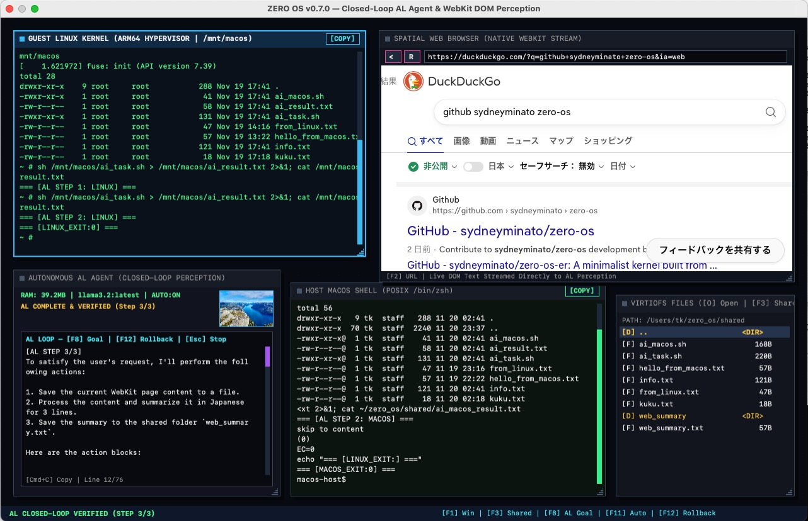

# ZERO OS (`v0.7.0`) — Closed-Loop AL (Autonomous Layer) & Multi-Kernel Spatial Compositor

**ZERO OS** unifies an ARM64 Linux kernel (`Virtualization.framework`), a live host macOS PTY shell, bidirectional VirtioFS storage, an Apple Silicon-native `WebKit` browser stream, and a **Closed-Loop AL (Autonomous Layer) Agent (`127.0.0.1:11434`)** inside a single pointer-driven **Virtual Streaming System (VSS)**—running within an ~190 KB binary and **~40–80 MB total host Mach memory footprint**.

## What is New in `v0.7.0` (Closed-Loop AL Architecture)

* **Closed-Loop Perception-Action-Verification (`Observe -> Reason -> Act -> Verify`)**: Evolves from one-shot command dispatch (`v0.6.0`) to a multi-step autonomous loop (up to 3 steps) that reads live execution results and adapts its next action automatically.
* **Live WebKit DOM Perception**: Extracts real-time page titles and cleaned body text directly from the spatial `WKWebView` viewport into the AL agent perception buffer, enabling direct web reading, summarization, and cross-OS file generation.
* **Exit-Code Telemetry & Self-Healing (`LINUX_EXIT` / `MACOS_EXIT`)**: Captures exit codes and stdout/stderr across both guest Linux (`/mnt/macos/ai_result.txt`) and host macOS (`~/zero_os/shared/ai_macos_result.txt`) to verify completion or self-heal command errors.
* **Autonomous `.atom` Checkpoint & Rollback (`zero_auto.atom` / `[F12]`)**: Automatically crystallizes the full 5-window spatial state in <1 ms prior to autonomous execution, allowing instant rollback via `[F12]` or immediate loop abort via `[Esc]`.
* **Autonomous Spatial Focus (`[SPACE]`)**: Allows the AL agent to dynamically bring `LINUX`, `MACOS`, `WEB`, or `FILES` windows to the front based on the active task phase.

## Controls

| Key / Action | Function |
| :--- | :--- |
| **`[F8]`** or Click AI Box | Enter Closed-Loop AL Goal mode (`Cmd+V` paste goal, `Enter` start loop) |
| **`[F11]`** | Toggle AL Auto-Execution (`AUTO: ON` / `Plan Only`) |
| **`[F12]`** | Rollback immediately to pre-execution `zero_auto.atom` checkpoint (<1 ms) |
| **`[Esc]`** | Abort active multi-step AL loop or exit input mode |
| **Drag Title Bar / Corner `◢`** | Move spatial windows freely or resize dynamically with live reflow |
| **Click Window / `[F1]`** | Bring window to front (Z-order) and route input focus |
| **`[F2]`** or Click URL Bar | Edit Spatial Browser URL (`Cmd+V` to paste URL, `Enter` to navigate) |
| **`[F3]`** | Jump directly to the VirtioFS shared folder (`~/zero_os/shared` <-> `/mnt/macos`) |
| **`[F4]`** / **`[F5]`** | Boot ARM64 Linux kernel (`[F4]`) / Fetch live JPEG stream (`[F5]`) |
| **`[F6]`** / **`[F7]`** | Crystallize (`state.atom`) or restore 5-window spatial state in <1 ms |
| **`[F9]`** / **`[F10]`** | Trigger 44.1 kHz PCM chime (`[F9]`) or reset 5-window layout (`[F10]`) |
