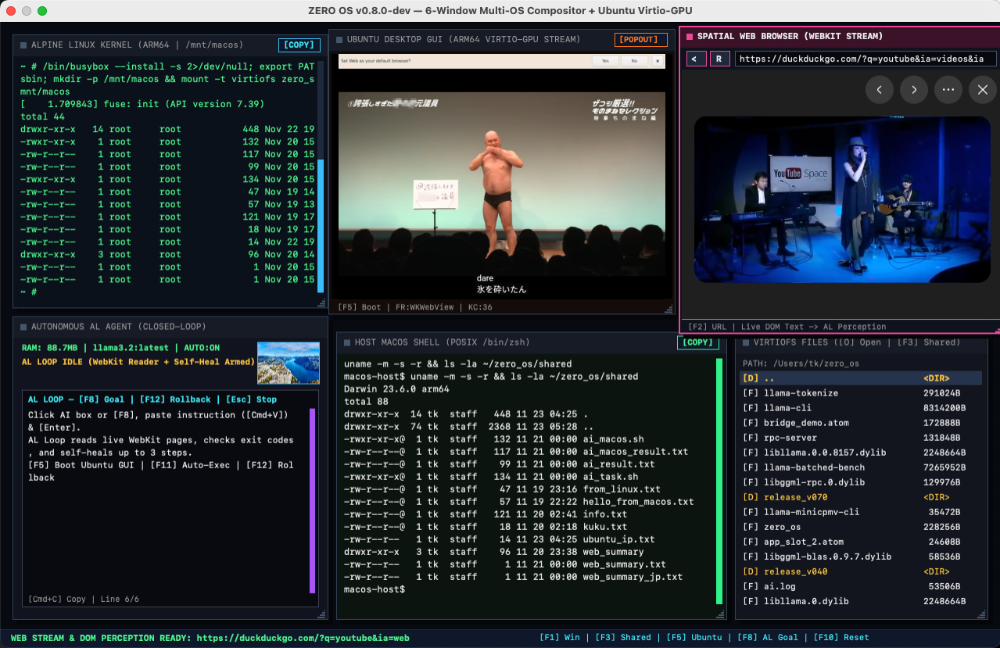
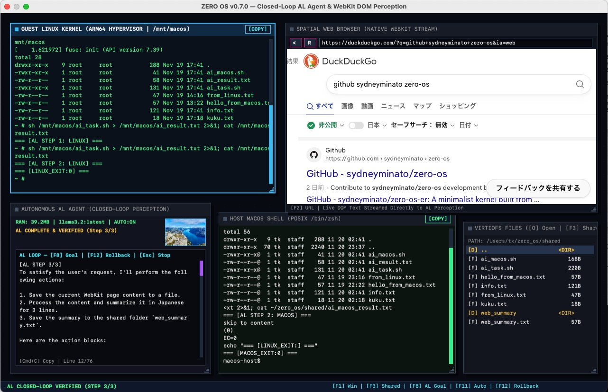
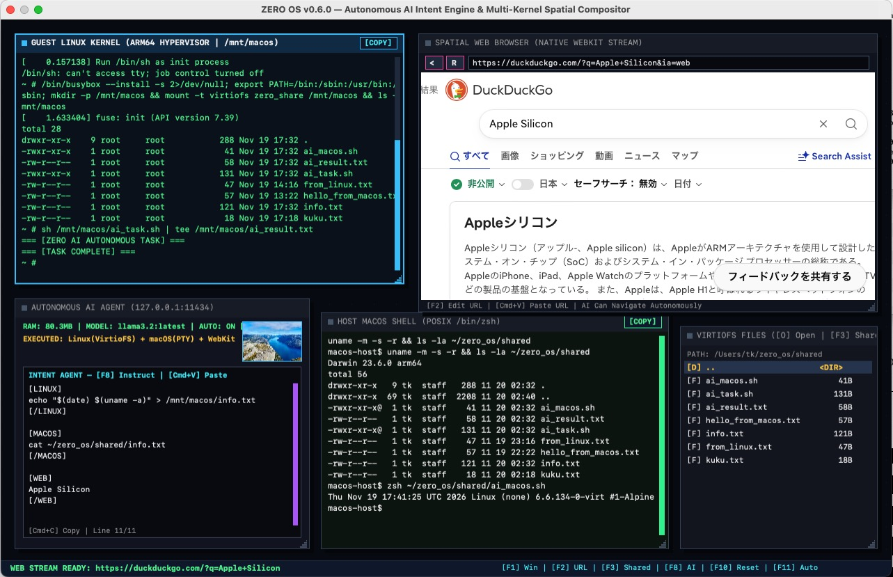
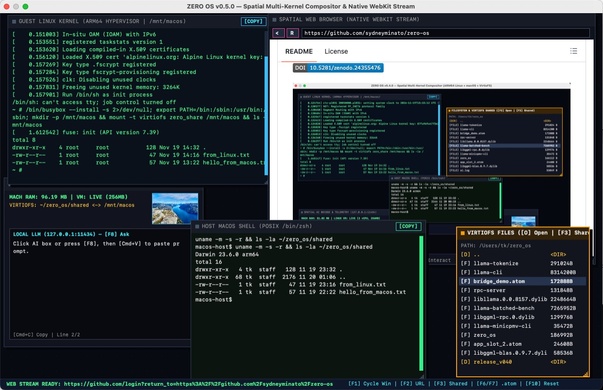
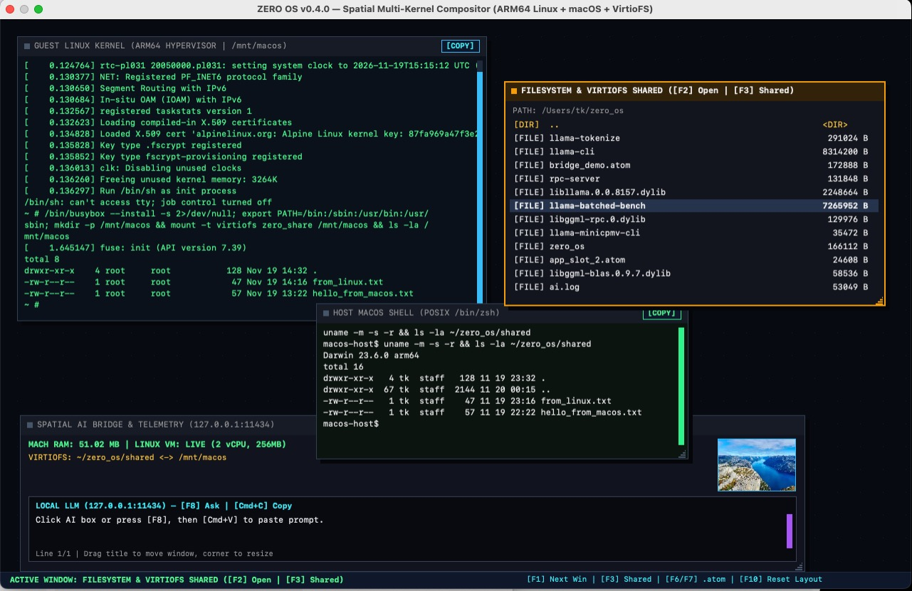
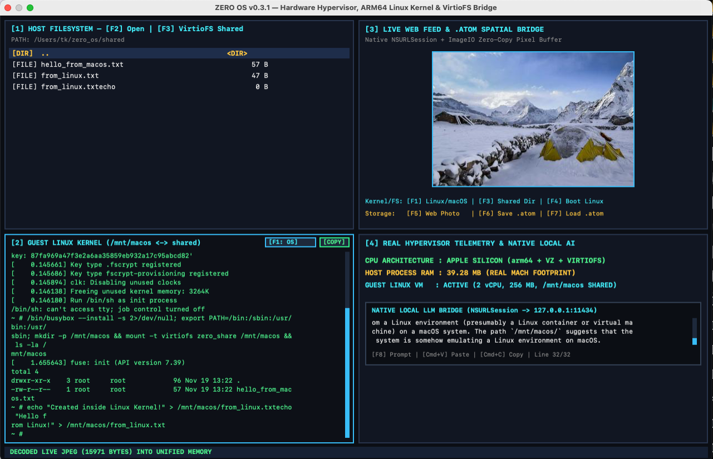
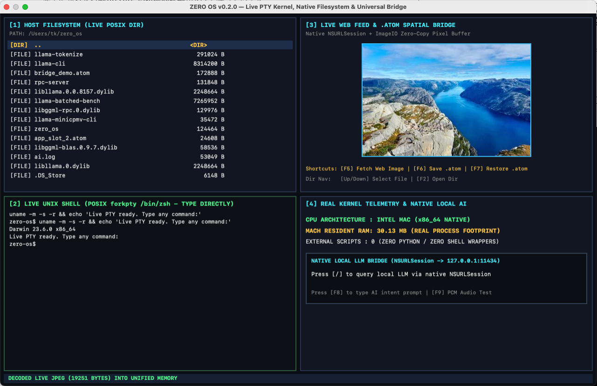
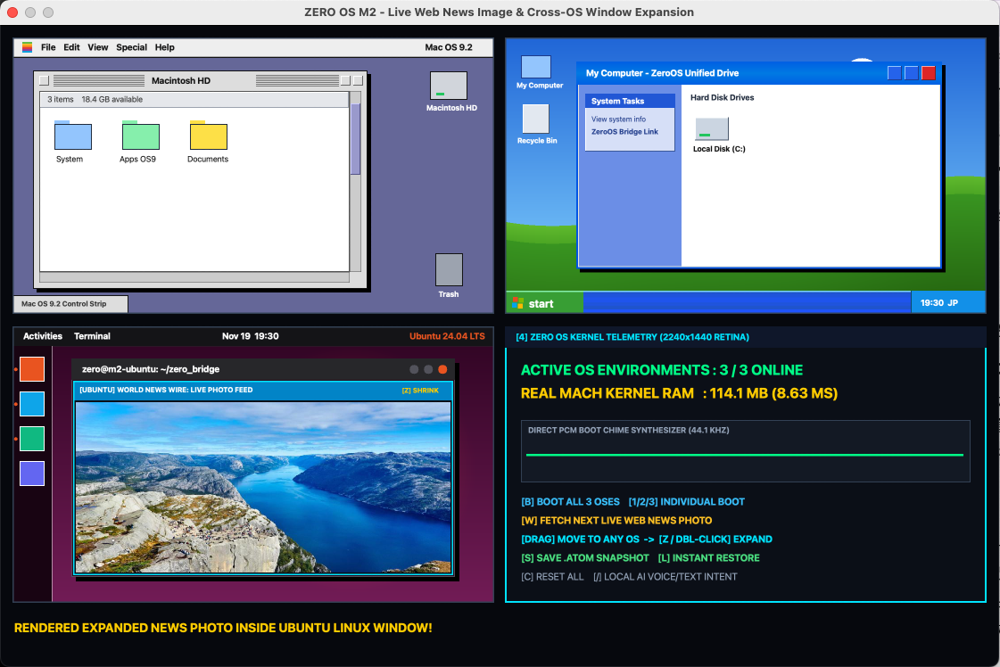

# ZERO OS (`v0.8.0`) — Virtio 音声出力・双方向クリップボード共有・マルチ OS 空間コンポジタ

[English / Bilingual README →](README.md)

**ZERO OS** は、macOS 上で動作する C / Objective-C 製の超軽量な空間マルチ OS コンポジタです。**`v0.8.0`** では、ハードウェア支援による Virtio 音声出力、macOS と Linux 間の双方向クリップボード共有、および描画安定化（`draw_text` の修正）を実装し、8GB メモリの Apple Silicon Mac 上で Debian 12（XFCE デスクトップ）・ホスト側 WebKit ブラウザ・Alpine Linux・ローカル AI エージェントを同時に軽快動作させる環境を確立しました。

---

## `v0.8.0` の主な新機能・改善点

- **Virtio オーディオ出力に対応（`VZVirtioSoundDeviceConfiguration`）**: ゲスト OS（Debian 12 ARM64 / `bookworm-backports` カーネルの `virtio_snd` ＋ PipeWire）の音声を macOS ホスト側へ直接出力できるようにしました。
- **双方向クリップボード共有（`VZSpiceAgentPortAttachment`）**: `sharesClipboard = YES` を有効化し、macOS と Linux 仮想マシン間でテキストのコピー＆ペーストをシームレスに行えるようにしました。
- **軽量マルチメディア・GUI 環境の最適化**: 8GB RAM の M2 Mac mini 上で、Debian 12 ARM64（メモリ 2GB 割り当て / XFCE / Epiphany / Fcitx 5 + Mozc）とホスト側 WebKit ブラウザの 2 画面同時動画再生を、Alpine Linux やローカル AI と並走させながら快適に動作することを確認しました。
- **描画クラッシュの修正（`draw_text`）**: `zero_core.c` の `draw_text` 関数にフォント・色・サイズの空値（`nil`）チェックとフォールバック処理を追加し、文字描画時の突然の例外終了を防止しました。

---

## 開発の変遷（`v0.8.0` → `v0.1.0-alpha`）

### `v0.7.0` — クローズドループ AL（自律レイヤー）＆ マルチカーネル空間コンポジタ

- **自律ループ制御（観察 → 推論 → 実行 → 検証）**: 単発のコマンド送信から、実行結果を読み取って次の行動を自動修正する最大 3 ステップの自律ループ制御へ進化しました。
- **WebKit 画面内容のリアルタイム認識**: 空間内の `WKWebView` で開いている Web ページのタイトルと本文を直接取得し、ローカル AI が内容を要約・活用できるようにしました。
- **終了コード監視と自己修復（`LINUX_EXIT` / `MACOS_EXIT`）**: ゲスト Linux とホスト macOS 双方の終了コード・標準出力を取得し、完了確認やエラー時の自動リカバリを実現しました。

### `v0.6.0` — 自律 AI インテントエンジン ＆ マルチカーネル空間コンポジタ

- **OS 横断の自律 AI 実行（`[LINUX]` / `[MACOS]` / `[WEB]`）**: 日本語・英語の自然言語指示から実行スクリプトを生成し、ゲスト Linux・ホスト macOS・WebKit ブラウザを横断して自動実行する基盤を実装しました。
- **OS 間のパス自動変換**: ホスト側とゲスト側で異なる共有フォルダパス（`~/zero_os/shared` ↔ `/mnt/macos`）を C ブリッジ内でリアルタイムに自動補正します。
- **30fps 安定オーバーレイ描画**: ウィンドウ同期処理を `drawRect:` から分離し、動画再生中も安定した 30fps の空間コンポジット描画を実現しました。

### `v0.5.0` — 空間マルチカーネルコンポジタ ＆ ネイティブ WebKit ストリーム

- **超軽量ネイティブ WebKit ブラウザ統合**: macOS 標準のハードウェア支援 `WKWebView` を空間ウィンドウ（`WIN_BROWSER`）として統合し、重なり順（Z オーダー）に応じた自然なクリッピング描画を実現しました。

### `v0.4.0` — 空間マルチカーネルコンポジタ ＆ Virtual Streaming System

- **自由配置型マルチカーネル・ウィンドウコンポジタ**: 固定グリッド表示を廃止し、ドラッグ移動・リサイズ（`◢`）・前後重ね合わせが自在にできる空間ウィンドウコンポジタを単一フレームバッファ上に実装しました。

### `v0.3.1` — ネイティブ・ハードウェアハイパーバイザ ＆ ARM64 Linux カーネル起動

- **ネイティブ ARM64 Linux カーネルの高速起動**: Apple `Virtualization.framework` により、Apple Silicon 上で ARM64 Linux カーネルをエミュレーションなしの約 0.11 秒で直接起動することに成功しました。
- **VirtioFS による双方向ファイル共有**: macOS の共有フォルダ（`~/zero_os/shared`）をゲスト Linux の `/mnt/macos` に直接マウントし、ゼロ遅延でのファイル交換を実現しました。

### `v0.2.0` — ユニバーサルネイティブ空間コンポジタ ＆ ライブ PTY カーネル

- **約 124KB のユニバーサルバイナリ化（`arm64` + `x86_64`）**: 外部ライブラリ一切なしの約 124KB 単一バイナリで Apple Silicon と Intel Mac の双方で動作し、実ターミナル（PTY）・ホストファイル閲覧・`.atom` 状態スナップショットを統合しました。

### `v0.1.0-alpha` — 意図駆動・ゼロブロート計算アーキテクチャ

- **初期リファレンス実装**: 肥大化した従来 OS の中間レイヤーを排し、ユニファイドメモリ上の純粋データ構造を画面フレームバッファと音声ハードウェアへ直接マッピングする初期アーキテクチャを確立しました。
